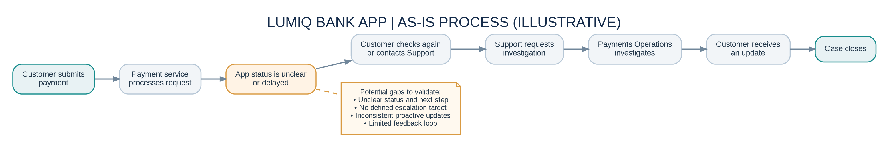
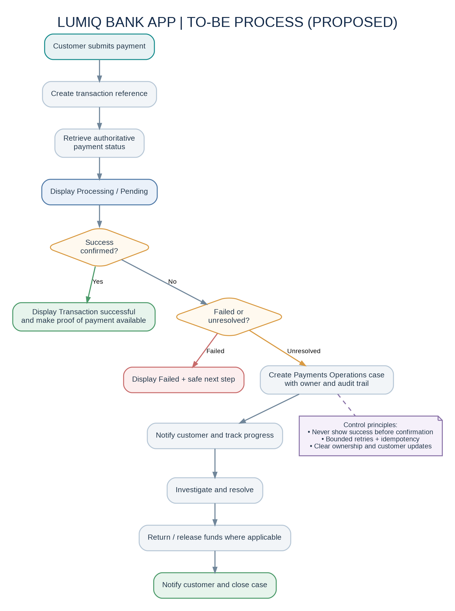

# LUMIQ Bank App — Business Analysis Case Study

**By Bulelwa Bisholo** · **Fictional portfolio simulation** · **Digital banking / payments**

> **Important:** LUMIQ Bank is fictional. All stakeholder roles, process details, requirements, scenarios and targets are illustrative. This is a portfolio simulation, not a real bank engagement. No real customer research, production data or implementation is claimed.

## Project overview

This case study explores a customer and operational problem: customers may not receive clear confirmation of what happened after initiating a payment. Ambiguous or delayed statuses can create uncertainty, repeat-payment risk and avoidable support enquiries.

The proposed future state improves transaction-status visibility, gives customers clear next steps, introduces a controlled exception and escalation journey, and defines measures to evaluate the service.

## Process maps

### AS-IS — illustrative current state



### TO-BE — proposed future state



Editable Mermaid source files are available in [`process-maps/`](process-maps/).

## Business analysis deliverables

| Area | Artefacts |
|---|---|
| Initiation | Executive summary, problem statement, objectives, scope |
| Stakeholders | Stakeholder register and engagement approach |
| Elicitation | Proposed interviews, document review, customer validation |
| Process analysis | AS-IS, gap analysis and TO-BE process maps |
| Requirements | Business, functional, non-functional requirements and business rules |
| Agile analysis | 9 user stories with acceptance criteria |
| Traceability | Requirements Traceability Matrix |
| Testing | UAT scenarios, defect and sign-off approach |
| Governance | RAID register |
| Outcomes | KPI definitions, recommendations and next steps |

## Repository guide

```text
LUMIQ-Bank-App-BA-Case-Study/
├── README.md
├── LUMIQ_Business_Analysis_Case_Study.pdf
├── LUMIQ_Business_Analysis_Case_Study.docx
├── assets/
│   ├── AS-IS.png
│   ├── AS-IS.svg
│   ├── TO-BE.png
│   └── TO-BE.svg
├── process-maps/
│   ├── AS-IS.mmd
│   └── TO-BE.mmd
├── artefacts/
│   ├── requirements-and-user-stories.md
│   └── RTM-and-UAT.md
└── presentation/
    └── LUMIQ_Executive_Overview.pptx
```

## Proposed solution principles

- Use the authoritative transaction record for customer-facing status.
- Show `Processing` / `Pending` until success is confirmed.
- Show `Transaction successful` only after authoritative confirmation.
- Make proof of payment available after confirmed success.
- Use bounded retries and idempotency controls to prevent duplicate processing.
- Route unresolved exceptions to Payments Operations with ownership and audit history.
- Keep customers informed through appropriate channels.
- Correct bank-side processing errors through return/release to the original method where supported.

## Validation and limitations

- The AS-IS process and pain points are hypotheses to validate, not verified facts.
- Proposed stakeholder roles are not actual interview participants.
- The suggested customer sample and service targets are planning assumptions, not completed research or agreed SLAs.
- KPI baselines and improvement percentages are not claimed.
- The solution is conceptual; implementation, integrations, regulatory review and production testing are outside this case study.

## How to discuss this project

“I created a fictional digital-banking case study to practise the end-to-end Business Analysis lifecycle. I framed a customer and operations problem, mapped an assumed current state, identified gaps to validate, designed a future state, documented requirements, wrote user stories and acceptance criteria, linked requirements to UAT, and prepared a RAID register and success measures. I clearly separated assumptions from verified findings because this was a portfolio simulation.”

## Author

**Bulelwa Bisholo**  
Portfolio: https://bulelwa-bisholo.github.io  
GitHub: https://github.com/BulelwaBisholo
